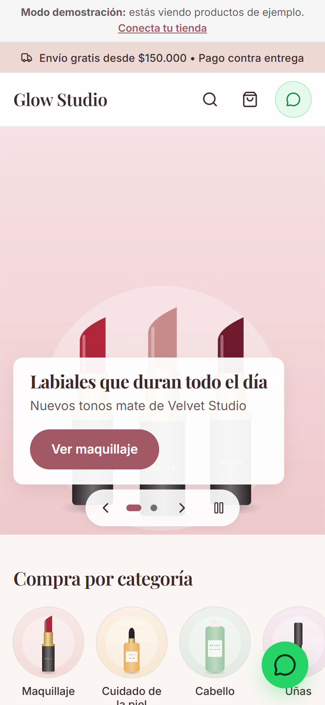
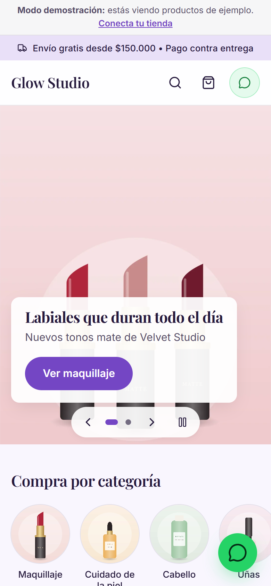
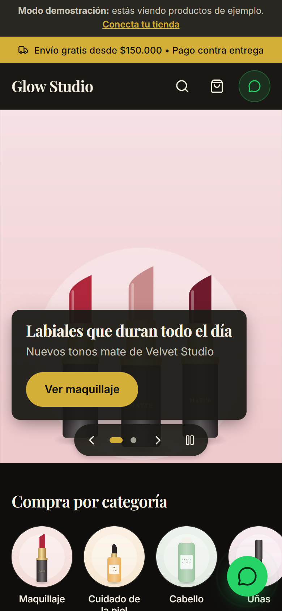

# Manual de uso de tu tienda

Este manual explica cómo manejar tu tienda día a día desde el panel. Si todavía no la tienes publicada, empieza por la [Guía de instalación](GUIA_INSTALACION.md).

**Tu panel está en:** `https://TU-DIRECCION/admin` (tu dirección + `/admin`). Entras con la misma cuenta con la que creaste Sanity (Google o GitHub).

---

## Lo más importante: publicar y recargar

1. Cada cambio en el panel se guarda solo como **borrador**.
2. Para que se vea en la tienda toca **Publish** (abajo a la derecha). Cuando dice **Published** en gris, ya está publicado.
3. Abre tu tienda y **recarga la página**. Los cambios aparecen en unos segundos (a veces tarda hasta un minuto).

> Si algo no se ve: ¿tocaste **Publish**? ¿Recargaste? Esos dos pasos resuelven casi todo.

**¿Me equivoqué?** Cada producto y ajuste guarda su historial. Toca el ícono del reloj (**History**) arriba a la derecha del documento, elige una versión anterior y toca **Restore**. Luego **Publish**.

---

## Cómo está organizado el panel

A la izquierda verás:

| Sección | Para qué sirve |
|---|---|
| **Configuración de la tienda** | Nombre, moneda, logo, colores, letras, textos, WhatsApp, carrito, filtros, redes, franja superior y estadísticas |
| **Portada** | Lo que se ve al entrar a la tienda: banners, estantes, categorías… |
| **Productos** | Tus productos, con listas rápidas de agotados, ocultos, en oferta y por categoría |
| **Categorías** | Cómo agrupas tus productos (Labios, Rostro, Cabello…) |
| **Marcas** | Las marcas que vendes (opcional) |

Y en la barra de arriba, **Primeros pasos**: tu lista de tareas pendientes y la tienda de ejemplo.

---

## Productos

### Crear un producto
**Productos** → **Todos (arrastra para ordenar)** → botón **+**. El producto tiene cinco pestañas:

**🛍️ Datos básicos**
- **Nombre del Producto** (obligatorio). Ej.: Labial Mate Larga Duración.
- **Identificador URL (Slug)** (obligatorio): toca **Generate** y se crea solo desde el nombre. Es la dirección del producto (`/producto/labial-mate-larga-duracion`). Si lo cambias después, los enlaces que ya compartiste dejan de funcionar.
- **Precio de venta** (obligatorio): solo números, sin puntos ni símbolo. Ej.: `45000`.
- **Precio antes (opcional)**: si tiene descuento, el precio anterior. Se muestra tachado y la tienda calcula el porcentaje de descuento.
- **Categoría** (obligatoria) y **Marca (opcional)**.
- **Código SKU / Referencia (Opcional)**: tu código interno. Sale en la ficha y en el mensaje de WhatsApp.
- **Etiqueta o Insignia (Opcional)**: un letrero sobre la foto: **Nuevo**, **Oferta**, **Destacado** o **Más popular**.
- **Etiquetas para filtrar (opcional)**: escribe una y presiona Enter. Ej.: vegano, piel grasa. Tus clientes pueden filtrar por ellas y el buscador las encuentra.

**📷 Fotos**
- **Fotografías del Producto** (al menos una). La primera es la principal.
- **Punto importante de la foto:** en cada foto toca el lápiz (**Edit**) y mueve el círculo al centro de lo importante (el labial, la cara de la modelo). La tienda recorta las fotos para que todas tengan la misma forma, y así nunca corta esa parte. También se usa en la vista previa al compartir por WhatsApp.
- **Descripción de la foto (opcional)**: una frase de lo que se ve. Ayuda a personas con lectores de pantalla y a Google. Si la dejas vacía se usa el nombre del producto.

**🎨 Tonos y opciones**
- **Nombre de las opciones**: cómo se llaman. Ej.: Tono, Tamaño, Aroma.
- **Opciones (opcional)**: agrega una por cada tono o tamaño. Cada opción tiene:
  - **Nombre de la opción** (obligatorio). Ej.: Rojo Carmesí, 30 ml.
  - **Color de muestra (opcional)**: un código de color como `#B0263A`; la ficha muestra un circulito de ese color. Si no es un color, déjalo vacío y se muestra un botón con el nombre.
  - **Foto de esta opción (opcional)**: al elegir el tono, la ficha cambia a esta foto.
  - **Precio de esta opción (opcional)** y **Precio antes de esta opción (opcional)**: solo si cuesta distinto. La tarjeta del catálogo muestra "Desde $…" cuando las opciones tienen precios distintos.
  - **Código / referencia (opcional)**.
  - **¿Disponible?**: apágalo si ese tono se agotó. Se verá tachado y el botón cambia a "Preguntar disponibilidad".
- Al elegir un tono, la dirección del producto cambia (ej. `?tono=coral`): si compartes ese enlace, se abre con ese tono elegido.

**📝 Descripción e información**
- **Resumen Corto**: una frase para las tarjetas y la vista previa al compartir.
- **Descripción Detallada**: puedes usar saltos de línea (Enter).
- **Características Clave (Puntos Destacados)**: lista de beneficios.
- **Información adicional (opcional)**: secciones desplegables en la ficha, con **Título** y **Texto**. Ej.: Modo de uso, Ingredientes, Advertencias. La primera aparece abierta.

**👁️ Visibilidad**
- **¿Está Disponible en Stock?**: apágalo cuando se agote. Qué pasa con los agotados lo decides en Configuración (ver [WhatsApp y pedidos](#whatsapp-carrito-y-datos-del-cliente)).
- **Ocultar de la tienda**: el producto desaparece de la tienda sin borrarlo (útil para productos de temporada). Su enlace responde "no encontrado".

Al terminar toca **Publish**.

### Listas rápidas
En **Productos** tienes: **Agotados**, **Ocultos**, **En oferta** (los que tienen precio antes) y **Por categoría**.

### Ordenar productos, categorías y marcas
En **Productos → Todos (arrastra para ordenar)**, **Categorías** y **Marcas**, arrastra cada elemento desde su borde izquierdo a la posición que quieras. El orden se guarda solo (no hace falta **Publish**) y es el que usa la tienda en "Destacados".

> Si tus productos existían antes de esta versión y no se dejan ordenar, abre el menú **⋯** de la lista y toca **Reset order** una vez.

### Duplicar o borrar
En el menú **⋯** (arriba a la derecha del producto): **Duplicate** crea una copia (cámbiale nombre y slug) y **Delete** lo borra. Si solo quieres que no se vea, mejor usa **Ocultar de la tienda**.

---

## Categorías y marcas

**Categorías** → **+**:
- **Nombre de la Categoría** y **Identificador URL (Slug)** (**Generate**).
- **Ícono**: se ve junto al nombre en los botones de categorías (hay una lista con opciones de belleza).
- **Foto (opcional)**: se usa en la sección "Categorías" de la portada (recomendado: cuadrada, 600 × 600 px).
- **Descripción (Opcional)**: también la usa Google para la página de esa categoría.

**Marcas** → **+**: nombre, identificador (**Generate**), **Logo (opcional)** (PNG con fondo transparente, para la sección "Marcas" de la portada) y **Descripción corta (opcional)**. El filtro por marca del catálogo aparece cuando tienes 2 marcas o más.

Una categoría o marca que usa algún producto no se puede borrar: primero cambia esos productos a otra.

---

## Portada

**Portada** → **Secciones de la portada** → **Add item** y elige qué agregar. Arrastra las secciones para cambiar el orden. Si no hay ninguna sección, la tienda muestra una portada automática con tus categorías y productos nuevos.

| Sección | Qué muestra |
|---|---|
| **Banner principal** | Una o varias imágenes grandes que pasan como carrusel (**Pasar solas**). Cada diapositiva lleva imagen, imagen para celular (opcional), título, subtítulo, texto del botón y a dónde lleva. |
| **Estante de productos** | Una fila de productos con título. En **¿Qué productos mostrar?** eliges: Novedades, Ofertas (con precio antes), Productos con una insignia, Una categoría, Una marca o Elegidos a mano. **Cantidad máxima de productos**: de 1 a 24. |
| **Categorías** | Tus categorías como **Círculos con foto** o **Tarjetas**. |
| **Marcas** | Los logos de tus marcas. |
| **Bloques informativos** | De 1 a 6 bloques con ícono, título y texto. Ej.: Envíos a todo el país, Pago contra entrega. |
| **Banner de texto** | Un aviso destacado con botón opcional. Ej.: Solo hasta el domingo. |
| **Invitación a redes sociales** | Un texto con los enlaces de tus redes (salen de Configuración → Redes y contacto). |

**A dónde lleva un botón** (en banners y en la franja superior): Una categoría, Una marca, Un producto, Todo el catálogo u Otra dirección web.

Toca **Publish** al terminar.

---

## Apariencia

**Configuración de la tienda** → **🎨 Apariencia**. Todo se cuida para que el texto siempre se lea bien.

- **Paleta de colores**: combinaciones listas: 🌸 Blush Nude, 💗 Rosa Chic, 💜 Lavanda, 🏺 Terracota y Arena, 🌿 Spa Menta, 🤍 Blanco Minimal, 👑 Negro y Oro, 🍷 Ciruela Noche, 🌙 Obsidiana Índigo y 💚 Esmeralda Noche.
- **Color de tu marca (opcional)**: si tienes un color propio, escribe su código (ej. `#C2185B`) y la tienda arma los colores a partir de él (reemplaza la paleta). Con él eliges el **Tono de fondo**: Claro (blanco), Crema (cálido) u Oscuro.
- **Tipografía**: Elegante, Delicada, Moderna, Clásica o Limpia.
- **Esquinas de tarjetas y fotos**: Rectas, Suaves o Redondeadas.
- **Forma de los botones**: Píldora (muy redondeados), Redondeados o Rectos.
- **Forma de las fotos de producto**: Cuadrada (1:1), Vertical (4:5, recomendada para belleza) o Vertical alta (3:4).
- **Productos por fila en celular**: 1 o 2.
- **Qué mostrar en cada tarjeta de producto**: la marca, la categoría y el botón de pedido rápido por WhatsApp.

Ejemplos de la misma tienda con distintas paletas:

| Blush Nude | Lavanda | Negro y Oro |
|---|---|---|
|  |  |  |

**🖼️ Marca**: **Logotipo de la Tienda** (si no subes, se muestra el nombre), **Icono del Navegador (Favicon)** (el iconito de la pestaña; cuadrado, ej. 64 × 64 px) e **Imagen para compartir** (ver [Google y compartir](#google-y-compartir-por-whatsapp)).

---

## Textos

**Configuración de la tienda** → **💬 Textos**. Puedes cambiar **cualquier texto que ven tus clientes**: botones, títulos, avisos, mensajes del carrito, pie de página… Están agrupados en secciones plegables (Encabezado, Portada, Catálogo y búsqueda, Ficha de producto, Carrito y pedido, Pie de página, Avisos, Google y vista previa). Cada campo muestra su texto por defecto; si lo dejas vacío, se usa ese.

**🏷️ General** tiene lo básico: **Nombre de la Tienda / Negocio**, **Eslogan o Subtítulo**, **País para mostrar precios**, **Moneda**, **Mostrar centavos en los precios** y un símbolo propio de moneda si quieres cambiarlo.

---

## WhatsApp, carrito y datos del cliente

**Configuración de la tienda** → **📱 WhatsApp y pedidos**:

- **Número de WhatsApp para Pedidos**: con código de país, sin + ni espacios (ej. `573001234567`). Ahí llegan todos los pedidos.
- **Saludo del mensaje** y **Cierre del mensaje**: la primera y la última línea del mensaje que te llega.
- **Activar carrito**:
  - **Encendido**: tus clientes agregan varios productos (con su tono y cantidad) y te envían **un solo mensaje** con la lista, el total y sus datos. El carrito se guarda en el navegador del cliente y los precios se actualizan solos si los cambias.
  - **Apagado**: no aparece nada del carrito; cada producto se pide por separado con su botón de WhatsApp.
- **Pedir nombre** / **Pedir ciudad o barrio**: si están activos, son obligatorios para enviar el pedido. **Permitir notas**: una casilla opcional ("Es para regalo").
- **Monto mínimo para envío gratis (opcional)**: el carrito le muestra al cliente cuánto le falta.
- **Productos agotados**: **Mostrarlos como "Agotado"** (se ven con su etiqueta y el botón cambia a "Preguntar disponibilidad") u **Ocultarlos del catálogo** (tampoco se abre su ficha).

**Así llega un pedido:** tu saludo, la lista numerada (producto, tono, cantidad × precio, enlace), el total, el nombre, la ciudad, las notas y tu cierre. Si el pedido es muy largo, se envía sin los enlaces de cada producto.

**🛡️ Confianza** → **Sellos de confianza**: frases cortas con ícono en la ficha de producto (ej. Envíos a todo el país, Productos originales). Recomendado: 3. Si lo dejas vacío, no se muestran.

---

## Catálogo, búsqueda y filtros

**Configuración de la tienda** → **🔎 Catálogo y filtros**:
- **Filtros disponibles para tus clientes**: Marca, Rango de precio, Solo ofertas, Etiquetas y Solo disponibles. Solo aparecen si tus productos tienen esa información.
- **Orden inicial de los productos**: Destacados (tu orden manual), Novedades, Precio (menor o mayor), Nombre o Mayor descuento. El cliente también puede cambiarlo.
- **Productos por página**: cuántos se muestran antes del botón "Cargar más".

El buscador encuentra productos sin importar tildes ni mayúsculas ("rimel" encuentra "Rímel") y busca en nombre, marca, categoría, etiquetas, referencias, tonos y resumen. Los filtros quedan en la dirección de la página: puedes compartir un enlace ya filtrado (ej. solo ofertas de una marca).

---

## Redes, contacto y franja superior

**📣 Redes y contacto**: enlaces completos de Instagram, TikTok, Facebook y YouTube, correo, dirección y horario. Salen en el pie de página y en la sección "Invitación a redes sociales".

**📢 Franja superior**: una franja delgada arriba de todo con un aviso corto. **Mostrar franja superior**, **Texto de la franja**, **Ícono de la franja** y **Enlace de la franja (opcional)** (si lo pones, la franja se puede tocar).

---

## Google y compartir por WhatsApp

- **Vista previa al compartir**: cuando compartes un producto sale su foto (recortada con el punto importante), nombre y precio. Si compartes un tono (`?tono=coral`), sale ese tono con su precio y su foto. Para la portada y el catálogo se usa la **Imagen para compartir** de **🖼️ Marca** (ideal 1200 × 630 px); sin ella se comparte solo el texto.
- **Texto en Google**: **💬 Textos → Google y vista previa al compartir** tiene el texto que va después del nombre de la tienda y la descripción (se usa si el eslogan está vacío).
- La tienda arma sola el **mapa del sitio** para Google (`/sitemap.xml`) con tus productos y categorías. Los productos ocultos no aparecen.
- **📈 Google y estadísticas** (todo opcional; vacío = no se carga nada):
  - **Verificación de Google Search Console**: para registrar tu tienda en Google. Pega la etiqueta que te da Google (opción "Etiqueta HTML").
  - **Google Analytics 4**: el "ID de medición" (`G-…`) para ver cuántas personas te visitan.
  - **Píxel de Meta**: el identificador (solo números) para medir anuncios de Facebook e Instagram.
- Tip: después de cambiar la foto o el precio, WhatsApp puede seguir mostrando la vista previa vieja de un enlace que ya se compartió; con enlaces nuevos se ve bien.

---

## Trabajar con otras personas

- Invita a otra persona desde [sanity.io/manage](https://www.sanity.io/manage) → tu proyecto → **Members** → **Invite members** (rol **Editor** para cargar productos, **Administrator** para todo). Revisa en la [Guía de instalación](GUIA_INSTALACION.md#invitar-a-alguien-a-tu-panel).
- Pueden trabajar al mismo tiempo: el panel muestra quién está editando y los cambios se ven en vivo.

---

## Respaldo de tu información

- Todo lo que publicas (productos, fotos, ajustes) queda guardado en Sanity, no en tu computador.
- El **historial** de cada documento (ícono del reloj) te deja volver a versiones anteriores.
- Para una **copia completa** (por ejemplo, antes de hacer muchos cambios) se necesita un comando técnico; pídele a quien te ayude que inicie sesión (`npx sanity login`) y ejecute, en la carpeta del proyecto:
  `npx sanity dataset export production respaldo.tar.gz`
  y guarde el archivo. Con `npx sanity dataset import` se puede recuperar.

---

## Tienda de ejemplo

En **Primeros pasos → Tienda de ejemplo**:
- **Cargar tienda de ejemplo**: agrega productos, categorías, marcas y fotos de una tienda de belleza. No toca tus productos ni, si ya existen, tu configuración y tu portada.
- **Borrar datos de ejemplo**: quita solo lo de ejemplo. Lo que tu portada esté usando no se borra (el panel te avisa).

Lo que la tienda **no** hace (pagos, inventario, cuentas de clientes…) está en [Limitaciones y preguntas](LIMITACIONES_Y_PREGUNTAS.md). Si algo falla, mira [Solución de problemas](SOLUCION_DE_PROBLEMAS.md).
